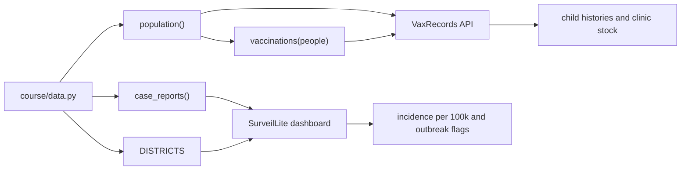

## In one minute

- **SurveilLite** is the course's disease surveillance dashboard: 40 clinics in 8 districts report weekly counts of measles, cholera and malaria, and it turns them into incidence per 100,000 people.
- **VaxRecords** is the course's vaccination records API: health workers record each dose, and it keeps each child's history and each clinic's stock.
- **Synthetic data** from `course/data.py` (`DISTRICTS`, `clinics()`, `case_reports()`, `population()`, `vaccinations()`) is generated from a fixed seed, so every run gives the same numbers and it is safe to share.
- **Deciding what "working" means** comes before design: for SurveilLite a wrong number is worse than a slow page, and for VaxRecords a lost dose record means a child may be vaccinated twice or not at all.
- Each module follows the same loop: read the README, answer `predict.md`, run the example, then fill in `exercises.py` until `pytest` passes.

## The picture

One seeded data module feeds both running systems: case reports and district populations feed SurveilLite, and children and their doses feed VaxRecords.

## Check yourself

Why must `incidence_per_100k()` list every district, even one with no cases of the disease?

A district missing from the table looks like "no data" rather than "zero cases", and an epidemiologist reading the dashboard cannot tell the two apart. Reporting an explicit 0 makes the absence of cases a fact the system states, not a gap the reader has to guess about.

Why does comparing the first half of the reporting period with the second half find the cholera outbreak in Coastal (S-COA), when the district with the most cholera cases might not?

An outbreak is a change over time, not a large total: a big district can have many cases every week without anything unusual happening. The ratio of second half to first half picks out the district whose cases grew, which is what `outbreak_district()` is asked to find.

What would go wrong if `course/data.py` used a different random seed on every run?

The tests, the examples and your own predictions would no longer agree, because the outbreak, the counts and the children would change each time. A fixed seed makes the data reproducible, so a surprising number is a real finding about your code rather than noise.

