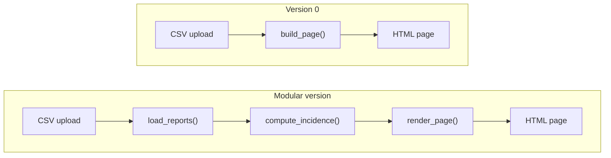

## In one minute

- **Complexity** rarely arrives all at once: SurveilLite starts as one script one person understands, then grows a new data source, a new disease and a second analyst until nobody can describe it in a paragraph.
- **Propagation of effects**: a small change in one place forces changes far away, as when `dashboard_v0.py` knows the date format in three places and a new upload format breaks all three.
- **Incommensurate scaling**: parts grow at different rates, so the naive duplicate check in `scaling.py` that compares every pair is instant for one clinic and takes hours for a country.
- **Modularity**, **abstraction**, **layering** and **hierarchy** are the four techniques for keeping growth under control, for example splitting `build_page()` into `load_reports()`, `compute_incidence()` and `render_page()`.
- **Design for iteration**: you will not get the design right first time, so make it cheap to change, which is exactly what modularity buys you.

## The picture

Version 0 tangles loading, computing and presenting in one function; the modular version gives each job its own function, so the date format lives only in `load_reports()` and the alert logic only in `compute_incidence()`.

## Check yourself

What would happen in `dashboard_v0.py` if clinics started uploading dates as "02/03/2026", and why is the modular version easier to fix?

The date format is hard-coded in three places, so every one of them must be found and changed, and missing one gives a crash or a wrong week. In the modular version only `load_reports()` knows the format, so the fix is a single `date_format` argument.

Why is the alert threshold in `build_page()` a sign of complexity, even though the cholera alert in Coastal still appears correctly?

The threshold that decides whether an epidemiologist sees ALERT is buried in HTML-building code, so changing the public health rule means editing presentation code and risking the layout. A decision about outbreaks belongs with the computation, behind an interface, where it can be found, tested and changed on its own.

If the naive duplicate check takes 1 second on 10,000 reports, why will it not take about 100 seconds on 1,000,000?

Comparing every pair grows with the square of the input, so 100 times more reports means about 10,000 times more work: roughly 10,000 seconds, nearly three hours. Remembering keys in a set grows linearly, which is why `find_duplicate_reports()` can handle 600,000 rows in seconds.

