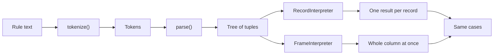

## In one minute

- Almost any system can be described with three abstractions: **memory** (`READ`, `WRITE`), **interpreter** (fetch, decode, execute, repeat) and **communication link** (`SEND`, `RECEIVE`).
- **Read/write coherence** means a `READ` returns the most recent `WRITE`, yet two clinics that each read a child's dose list, append a dose and write it back can still cause a **lost update**.
- **Before-or-after atomicity** is the property we actually want: one clinic's update happens entirely before or entirely after the other's, which a version check (`write_if`) provides.
- An **interpreter** appears whenever rules are data and a program follows them: `case_definition.py` tokenizes, parses and evaluates "fever AND (rash OR cough) AND age < 15", so an epidemiologist can change the case definition without a deployment.
- **One abstraction, two implementations**: `RecordInterpreter` and `FrameInterpreter` run the same tree and give the same answers at very different speeds, because the meaning is fixed by the interface and the implementation is free to change.

## The picture

A case definition goes from text to tokens to a tree, and the same tree then runs on two different interpreters that agree on every answer.

## Check yourself

Clinic A and Clinic B each read a child's dose list, append a dose and write it back. Why is a dose lost even though every write was coherent?

The second write was based on a stale read that did not include the first clinic's dose, so it overwrites that dose. "The last write wins" is true of the memory but wrong for the epidemiologist; a version check that refuses a write if anyone wrote since you read, then retries, prevents the loss.

Why is "fever AND rash OR cough" a different case definition from "fever AND (rash OR cough)"?

The parser makes `AND` bind tighter than `OR`, so the first rule means "(fever AND rash) OR cough" and counts every patient with a cough, fever or not. The parentheses change the tree, and the tree is what the interpreter executes.

Why does `WITHIN 14 DAYS OF onset` need the interpreter to keep state, when `age < 15` does not?

`age < 15` can be answered from the current record alone, but "within 14 days of onset" depends on the first visit the interpreter saw for that patient. Like a processor keeping registers, the interpreter must remember earlier records (via `before_each`) to execute this instruction.

