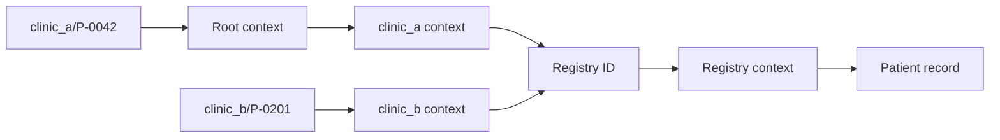

## In one minute

- **The naming model**: a **binding** associates a name with a value, a **context** is a set of bindings, and **resolution** looks a name up in a context; in Python a dict is a context.
- **Context matters**: "P-0042" names different children at Clinic A and Clinic B, so a report carrying only "P-0042" cannot be resolved, while a **path name** like `clinic_a/P-0042` names the context first.
- **Overloaded names** pack meaning into the name and break: keying children by name plus date of birth merges two Paul Uwimanas into one child who seems to have had most vaccines twice.
- **Name collisions** hide in URLs too: two districts called "Central" mean `/districts/Central/cases` silently resolves to one of them, and North Central's 182,000 people have no URL at all.
- **Indirection** binds a name to another name: clinics bind local IDs to registry IDs, so a child who moves keeps one history, a corrected birth date is fixed once, and a renamed clinic keeps an **alias**.

## The picture

`resolve()` walks a path name one component at a time; two clinics' local names lead to the same registry ID, so both see the single record held in the registry.

## Check yourself

Why does a dictionary keyed by "given name, family name, birth date" give a false vaccination coverage figure?

Two different children with the same name and birth date get the same key, and the dict silently keeps only one binding, so their dose histories merge into one child. That child appears to have had vaccines twice while the other disappears, which distorts coverage and can lead to a missed dose.

What would go wrong if each clinic stored its own copy of the child's record instead of binding its local ID to a registry ID?

A correction such as a mistyped birth date would have to be made in every copy, and any copy left unchanged would disagree with the others. With indirection the fix is made once in the registry and every name that leads there sees it.

Why should an ambiguous district name like "Central" get a 300 reply with choices rather than the most likely district?

A guess is wrong some of the time and nothing tells the user, so the dashboard quietly shows the wrong district's cases. Answering with the unambiguous URLs (`/districts/N-CEN/cases`, `/districts/S-CEN/cases`) makes the ambiguity visible and lets the caller choose.

