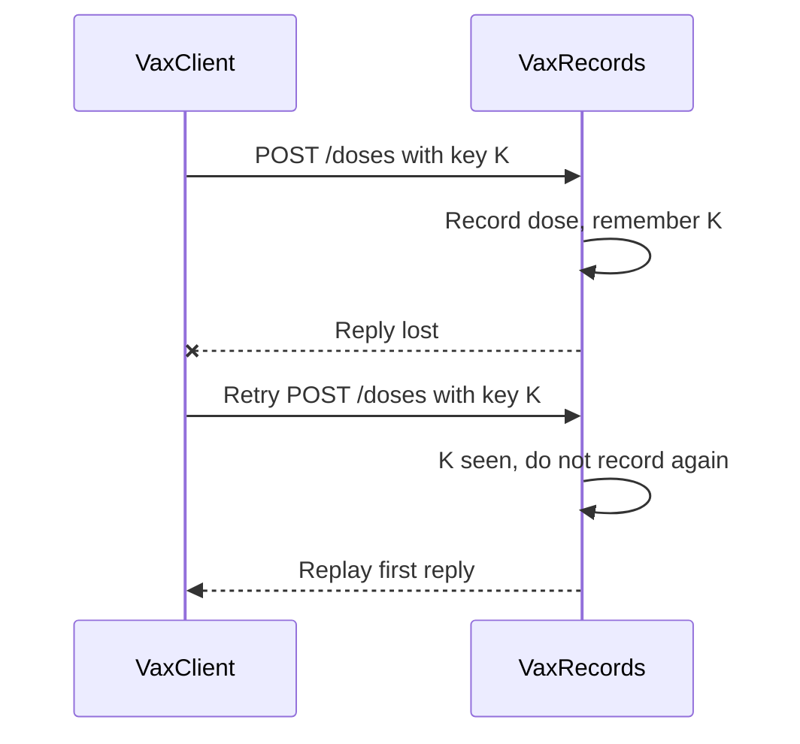

## In one minute

- **Enforced modularity** puts each module in its own program that talks only by messages, so a crash in the SurveilLite dashboard can no longer stop health workers recording doses in VaxRecords.
- **Remote procedure call (RPC)**: the **stub** `VaxClient` makes `client.record_dose(dose)` look like a local call, but a remote call can also be slow, go unanswered, or run twice.
- **The lost reply** is the hard case: the client times out and cannot tell whether the dose was recorded, so retrying gives **at-least-once** semantics and a child recorded as having an extra MCV1 dose.
- **Idempotency key**: the client creates one UUID per dose, outside the retry loop, and the service replays its earlier reply for a key it has seen, which together give the effect of **exactly-once**.
- The service must check and record under a lock, because two retries of the same dose can arrive at once.

## The picture

The first reply is lost after the dose is saved; the retry carries the same key, so the service replays its reply instead of recording a second dose.

## Check yourself

What would happen if `VaxClient` created a new idempotency key on every retry instead of once per dose?

Each retry would look like a brand new dose to the service, so a lost reply would still produce a duplicate record. The key only works because every attempt for one dose carries the same key.

Why is a duplicate dose record harmful for VaxRecords, when retrying "set Amina's MCV1 date to 2 March" would be harmless?

Setting a date is idempotent: running it twice leaves the same state. Adding a dose is not, so a duplicate makes the register say a child had a second measles dose, inflates coverage figures and makes stock look lower than it is.

Why does the dashboard crashing no longer take VaxRecords down with it?

The two now run as separate programs that share no memory and communicate only by HTTP messages, so a fault in one cannot corrupt or stop the other. The dashboard should in turn show "unavailable" when VaxRecords is down rather than crash itself.

