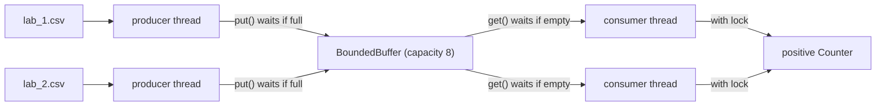

## In one minute

- **Virtualization** gives each module the illusion of its own processor, memory and communication link (a thread, an address space, a bounded buffer) while they all share one real computer.
- A **race condition** happens when `count += 1` is really three steps (read, add, write) and two threads interleave them, so one positive lab result silently vanishes.
- Wrapping the read-modify-write in `with lock:` makes it happen before or after any other thread's update, never in the middle, and the positive count in `lab_pipeline.py` becomes correct on every run.
- A **bounded buffer** sits between producer threads (one per lab file) and consumer threads (validating results): producers wait when it is full, consumers wait when it is empty, and nothing is dropped.
- Threads wait on a condition variable (`not_full`, `not_empty`) instead of spinning, always inside a `while` loop so they re-check after waking; `queue.Queue` is built exactly this way.

## The picture

Producers read lab files and put rows into the bounded buffer; consumers take rows out, reject garbage, and increment the shared positive count under a lock. The buffer coordinates sequence (who waits for whom), and the lock prevents lost updates.

## Check yourself

Why can the unlocked counter report fewer positives than the files contain, but never more?

Each lost update happens when two threads read the same old value and both write that value plus one, so one increment is overwritten. Nothing in the read-modify-write can add an extra increment, so the error only ever goes downward, which in surveillance means a quietly missed case.

What would happen if `BoundedBuffer.put` used `if` instead of `while` around `self.not_full.wait()`?

A woken producer would append without re-checking, even if another producer filled the freed slot first, so the buffer could grow past its capacity. The `while` makes each thread confirm the condition still holds after it wakes.

If you remove the `time.sleep(0)` and the lost updates seem to disappear, is the unlocked counter now safe for counting measles positives?

No. The race is still there; the pause only made the thread switch land between read and write on every run. Without it the switch happens rarely, so the count is wrong only occasionally, which is worse because nobody notices until an outbreak is missed.

