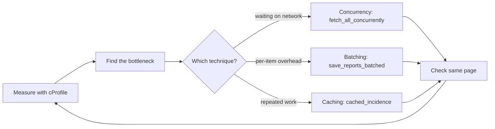

## In one minute

- **Measure first**: profile the slow SurveilLite refresh with cProfile, because the bottleneck is rarely where you guess (here it is SQLite commits, not pandas).
- **Batching** pays a fixed overhead once for many items: one transaction with `executemany()` for 1,440 rows instead of one commit per row.
- **Concurrency** overlaps waits: fetching 40 clinic reports with 10 threads leaves each fetch just as slow but finishes the whole set about ten times sooner.
- **Caching** keeps results close by and works when the working set is small (24 district incidence figures used 120 times), but it needs an invalidation rule or new outbreak reports never reach the dashboard.
- **Little's law**, N = X x R, sizes a VaxRecords mass vaccination day: 90 children an hour at 2.5 minutes each keeps 3.75 vaccinators busy, so plan for utilisation well below 1.

## The picture

The book's iterative loop: measure, fix the one bottleneck with the matching technique, confirm the faster version gives the same dashboard, then measure again until it is fast enough.

## Check yourself

Why did adding `lru_cache` to district incidence give only a small win, even with a high hit rate?

Incidence was never the bottleneck; most of the time went to waiting on the network and on per-row disk commits. Speeding up a stage that takes little time barely changes the total.

What would happen if a new cholera report arrived and `cached_incidence` was never invalidated?

The dashboard would keep showing the old incidence for that district, so a rising outbreak could stay invisible. That is why exercise 2's `IncidenceCache` invalidates exactly the entries a new report changes.

A vaccination clinic gets 90 children an hour and each dose takes 2.5 minutes. Why is 4 vaccinators risky even though it is more than the 3.75 Little's law says are busy?

At 4 vaccinators each is about 94% utilised, and as utilisation approaches 1, waiting time and the peak queue grow very fast with random arrivals. The clinic keeps up on average, yet children still wait a long time at busy moments.

