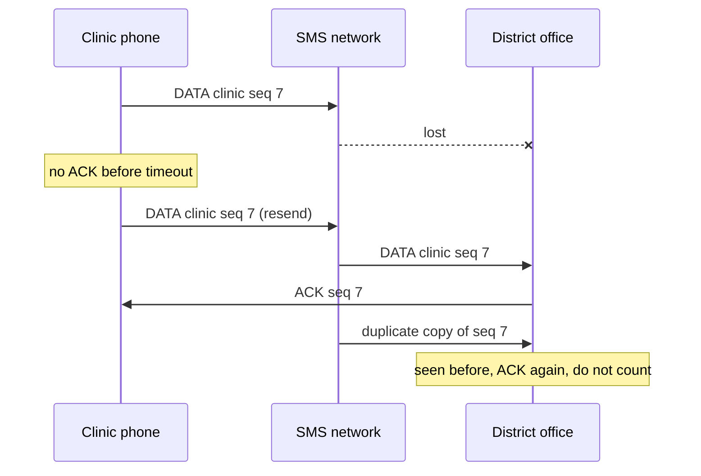

## In one minute

- The network layer promises only **best effort**: like SMS, a clinic's text may be lost, delivered twice, or overtake an earlier one.
- Fire-and-forget sending makes SurveilLite's district totals wrong both ways: lost texts hide cholera cases, duplicated texts raise false alarms.
- **Sequence numbers, acknowledgements and timeouts** give at-least-once delivery: a clinic resends any report whose ACK has not come back in time.
- **Duplicate suppression** at the office (remember each clinic and sequence number, ACK every copy, count it once) adds at-most-once, and together they give exactly-once totals.
- The **end-to-end argument**: only the endpoints know what "correct" means, so the end-to-end check is always needed and a lower-layer check is only a performance aid.

## The picture

This is `send_reliably` in action: the timeout recovers the lost text (at-least-once), and the office's record of seen sequence numbers stops the duplicate from being counted twice (at-most-once).

## Check yourself

Why must the office send an ACK for a duplicate it has already counted, instead of ignoring it?

The duplicate may be a resend because the first ACK was lost. If the office stays silent, the clinic never hears back and keeps resending the same report forever.

What would happen to the texts sent if you set the timeout in `send_reliably` much shorter than the usual delivery delay?

Clinics would resend reports that were only slow, not lost, so retransmissions and SMS costs go up and the office drops more duplicates. Totals stay correct thanks to duplicate suppression, but you pay for wasted texts.

The SMS gateway already checks each text arrived intact. Why does SurveilLite still need its own end-to-end check that clinic totals add up?

The gateway cannot know a nurse typed 14 instead of 41 or that the office database dropped a row; only the application at the endpoints knows what a correct count is. The lower-layer check helps catch some errors earlier, but it cannot replace the end-to-end one.

