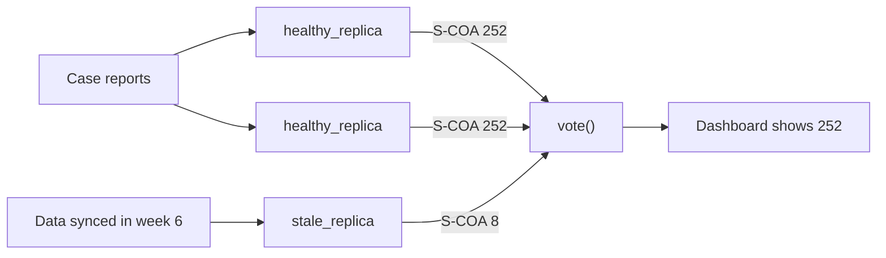

## In one minute

- A **fault** (a flipped bit, a bug, a stale copy) becomes an **error** (a wrong value inside) and then a **failure** (the dashboard shows the wrong incidence), much like exposure, infection and disease.
- **Fail fast**: `checked_incidence` refuses a negative case count or a zero population loudly, naming the report_id, instead of publishing a plausible wrong number.
- **Error detection** with a SHA-256 checksum turns a silent bit flip into a `CorruptionError`; **error masking** with redundant replicas still gives the right answer, and repair on read stops faults piling up.
- In `tmr_incidence.py` three replicas and a **voter** outvote one stale replica, but when two share the same stale data (a **common-mode fault**) the voter confidently picks the wrong answer.
- **Availability** = MTTF / (MTTF + MTTR): parts in series multiply and get worse, parts in parallel are down only when all are down, and shortening repair time helps as much as lengthening time to failure.

## The picture

Triple modular redundancy masks one faulty replica: two of three agree, so the voter publishes the true Coastal district incidence. If the stale data fed two replicas, the same vote would publish the wrong number.

## Check yourself

Why is a latent fault, like a bad byte sitting unread on disk, more dangerous than one that crashes the program?

Nothing tells you it is there, so it waits until it is read and quietly becomes a wrong case total. Checksums make it visible, and repair on read fixes it before a second fault hits the other copy.

What would happen if each TMR replica were right with probability 0.4 instead of 0.99?

TMR would be less reliable than a single replica, because the majority is more often wrong than right; the break-even point is r = 0.5. Voting only helps when each replica is usually right and they fail independently.

Running three copies of the same incidence code on three servers, why might this not protect the cholera dashboard from a bug?

All three copies share the bug, so they fail together and agree on the same wrong answer: a common-mode fault. The voter then reports that wrong incidence with full confidence, which is why independence matters more than the number of copies.

