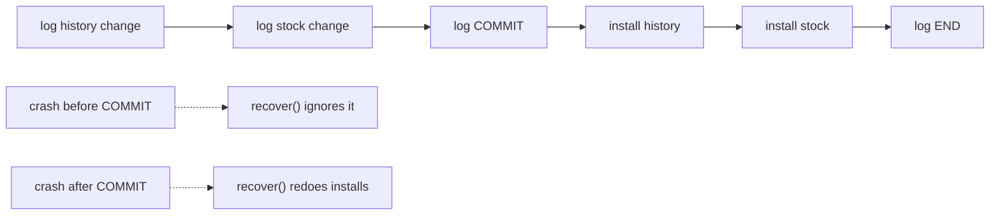

## In one minute

- **All-or-nothing atomicity** means a multi-step action either completes or leaves no visible trace, even if the power fails halfway through.
- Recording a dose in VaxRecords writes both the child's history and the clinic's stock, so a crash between the two breaks the invariant "stock left + doses given = stock received" and coverage and stock reports disagree.
- Every fix needs a **commit point**, one step that cannot be half done: the `os.replace` in `shadow_copy.py`, the COMMIT record in `wal_recorder.py`, or `COMMIT` in an SQLite transaction.
- **Before-or-after atomicity** is the concurrency twin: two health workers dispensing from the same stock can cause a lost update unless a lock covers both the read and the write.
- **Two-phase commit** stretches the commit point across two services, at the price that prepared participants are blocked if the coordinator crashes after deciding.

## The picture

The top row is `record_dose` in `wal_recorder.py`, with COMMIT as the commit point. A crash on either side of it is handled differently by `recover()`: before, the dose never happened; after, it is finished on start-up.

## Check yourself

Why must the stock change in the log say "set stock to 19" rather than "subtract 1"?

Recovery can itself crash and run again, so redoing an install must give the same result however many times it runs. "Set to 19" is idempotent; "subtract 1" would remove a dose from the stock each time recovery repeats.

What would happen if the WAL recorder installed the history change before writing the COMMIT record?

It would break the write-ahead rule. A crash before COMMIT would leave a dose in the history that recovery treats as never having happened, so the stock is never reduced and the invariant stays broken.

Two nurses at the same clinic each give a dose at the same moment and the stock goes from 20 to 19 instead of 18. Why, and why is a `threading.Lock` not enough in a Flask app with several worker processes?

Both read 20 before either wrote, so one update overwrote the other: a lost update. A Python lock only coordinates threads in one process, so the lock has to live where the data lives, such as the database row lock that `BEGIN IMMEDIATE` takes in SQLite.

