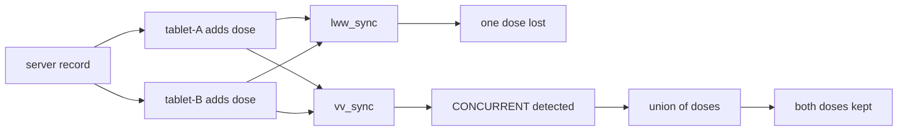

## In one minute

- **Strict consistency** means every read sees the latest write as if there were one copy, while **eventual consistency** lets replicas disagree for a while as long as they converge once updates stop.
- The right choice depends on what a stale answer costs: an hour-old SurveilLite incidence map leads to the same decision, but a nurse checking whether a child already had MCV1 cannot safely act on stale data.
- A **cache** is a replica kept for speed, and it stays honest by invalidating on every write or by promising a bounded staleness window with a time-to-live.
- **Last-writer-wins** sync replaces whole records by timestamp, so when two offline VaxRecords tablets each add a dose for the same child, one dose silently vanishes.
- **Version vectors** detect concurrent updates without trusting clocks, and because doses form a grow-only set the merge is simply a union, so replicas converge in any sync order.

## The picture

Both tablets start from the same record and go offline. `offline_sync.py` syncs them twice: last-writer-wins keeps one whole record and drops a dose, while version vectors spot the concurrent update and merge.

## Check yourself

Why does tablet-B's slow clock make last-writer-wins even worse?

"Later" is decided by the device timestamp, so a tablet whose clock runs 30 minutes slow loses even when its dose really was entered last. The outcome depends on cheap hardware clocks rather than on what actually happened.

What would happen if tablets synced with the server in a different order, or the same tablet synced twice?

With version vectors and the grow-only union, nothing changes: union is commutative and idempotent, so every order and every repeat converges to the same set of doses and the slot-by-slot maximum vector.

Why can the union rule merge doses automatically, but not a corrected birth date?

A dose, once given, stays given, so combining two sets of doses never contradicts anything. Two different birth dates genuinely conflict, and choosing between them needs a person who knows the domain, which is why good designs shape data so most updates are additions.

