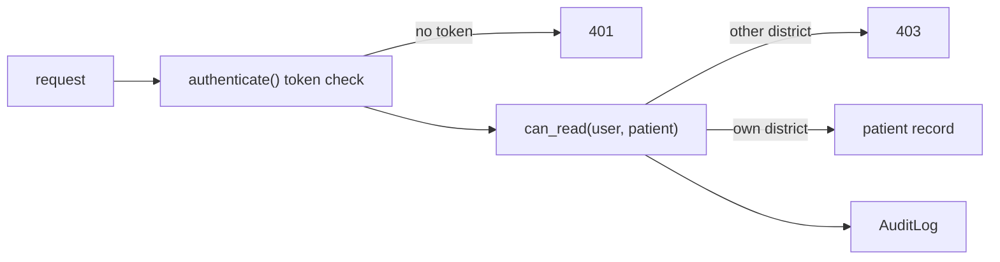

## In one minute

- Security is a **negative goal**: you must show that nobody can ever make the system misbehave, so you lean on a few design principles and a small structure you can check.
- The **guard model** puts every request through three steps: authenticate (who is asking), authorize (may they do this to this record), and audit (write down what happened).
- Being logged in is not being allowed: in `vax_api_insecure.py` any district officer can change the ID in `/patients/<id>` and read any child in the country, and the fix in `secure_vax_api.py` is one small `can_read` check on every read.
- A **tamper-evident audit log** chains hashes so that editing, deleting or reordering an entry breaks every link after it, as long as the latest hash is kept somewhere else.
- A hash detects change, an **HMAC** proves the sender knew a shared key (so SurveilLite's coverage requests cannot be altered or forged), and only encryption hides the data.

## The picture

Every request to VaxRecords passes the guard: `before_request` authenticates it, `can_read` authorizes it, and the outcome is recorded in the audit log whether it was allowed or denied.

## Check yourself

Amina, a North-Central district officer, asks for a patient from another district. Why does the secure version answer 403 both for "forbidden" and for "no such patient"?

If the two answers differed, she could probe IDs to learn which children exist in other districts. Giving the same answer leaks nothing, and the attempt still lands in the audit log for someone to notice.

Why are passwords stored as a salt plus a slow `scrypt` hash rather than a plain SHA-256 of the password?

If the user table leaks, the random salt stops one precomputed table from cracking everyone at once, and the deliberate slowness makes each guess expensive. A fast hash would let an attacker try billions of guesses cheaply.

What would happen if the HMAC on SurveilLite's request covered the body but not the timestamp?

An attacker could capture one genuine signed request and replay it later with a fresh timestamp header, and it would still verify. Signing the timestamp and rejecting old ones limits replay to a short window.

