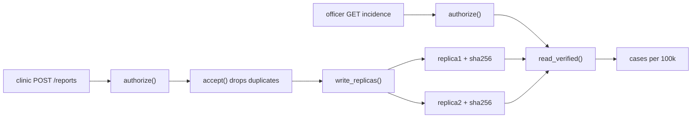

## In one minute

- Real systems need all the course's ideas at once, because failures arrive together: in the **bad week** a reply is lost, a clinic returns offline, a disk flips a digit and someone misbehaves.
- `accept(message, seen)` counts each (clinic, sequence number) once, so a retried or out-of-order report is neither doubled nor dropped.
- `read_verified(replica_paths)` returns only data whose SHA-256 checksum matches, repairs bad replicas, and raises an error when none is intact, because in surveillance **a missing number is better than a wrong one**.
- `authorize(user, action, district_id)` gives **least privilege** with fail-safe defaults: clinics submit only for themselves, officers read only their district, and everything else is denied and audited.
- With `NaiveParts` SurveilLite reports 459 cholera cases in Coastal instead of 140, a threefold outbreak that never happened.

## The picture

Reports enter through `authorize` and `accept` and are written to two checksummed replicas. Reads pass `authorize` again and then `read_verified`, which picks an intact copy and repairs the other.

## Check yourself

Clinic C31's phone sends a report, never hears back, and sends it again. What would the dashboard show without `accept`, and why is a (clinic, sequence number) key the right fix?

The report would be counted twice, inflating the case count. Keying on (clinic, sequence number) recognises the retry as the same message while still letting C32's out-of-order reports through, since each has its own number.

Why should `read_verified` raise an error instead of returning the first replica when no checksum matches?

Returning a corrupted copy, such as 310 cases instead of 31, would look like a real outbreak and drive real decisions. Failing fast makes the gap visible so someone fixes it, which is safer than a confident wrong number.

What would happen after a restart, given that `seen` is an in-memory set?

The set would be empty, so a retry arriving after the restart would be accepted and counted again. Storing `seen` in SQLite fixes this, but recording the key and storing the report must then happen atomically, which is Module 9's job.

